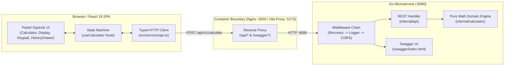
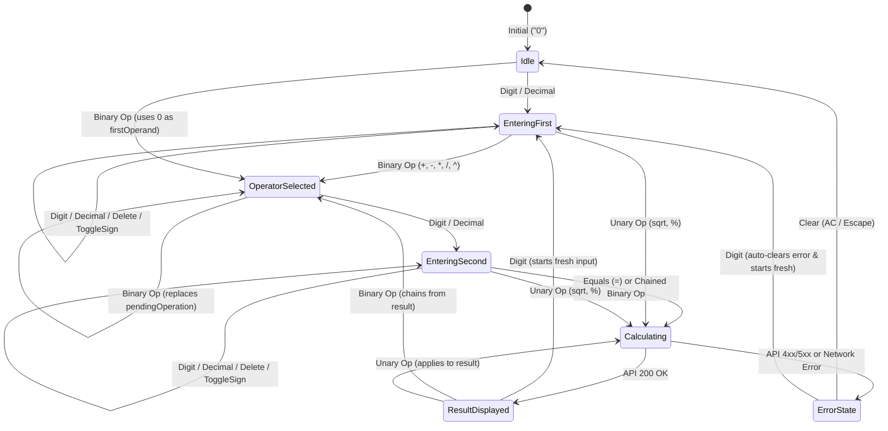

# Full-Stack Calculator Application — Architecture & Implementation Plan

> **Document Status:** Locked Architectural Blueprint (Phase 1)  
> **Target Executor:** Gemini 3.8 Flash High (Phase 2)  
> **Repository Root:** `.`  
> **Backend Stack:** Go (`module calculator-backend`, `net/http` Go 1.22+ enhanced routing, `swaggo/swag`)  
> **Frontend Stack:** React 19 + TypeScript + Vite 8 + Tailwind CSS + Lucide React + Vitest/RTL  

---

## 1. Architectural Design & Formal Specifications

### 1.1 System Overview & Architectural Principles

The application is a production-grade full-stack calculator separated into two strictly decoupled tiers within a single monorepo:

1. **Backend Microservice (`/backend`):** A stateless Go REST service exposing a unified calculation endpoint (`POST /api/v1/calculate`), a health probe (`GET /api/v1/health`), and interactive OpenAPI/Swagger documentation (`GET /swagger/index.html`). All mathematical operations, domain validations, and IEEE 754 floating-point boundary checks execute in a pure domain package (`internal/calculator`) with zero HTTP or framework dependencies.
2. **Frontend Single-Page Application (`/frontend`):** An accessible, tactile React + TypeScript application styled with an ergonomic soft-pastel design system and superellipse ("squircle") geometry. Presentation components are strictly separated from state orchestration (`useCalculator` hook) and network transport (`src/services/api.ts`).



---

### 1.2 Domain Logic Specification (`internal/calculator`)

#### Supported Operations (`Operation` Type)

The domain engine supports **7 canonical operations** divided into **5 binary operations** and **2 unary/hybrid operations**:

| Operation Identifier | Symbol | Arity | Mathematical Formula | Domain Constraints & Edge Cases |
| :--- | :---: | :---: | :--- | :--- |
| `"add"` | $+$ | Binary (`operand1`, `operand2` required) | $\text{result} = a + b$ | Rejects if `operand2 == nil`; checks result for $\pm\infty$ overflow. |
| `"subtract"` | $-$ | Binary (`operand1`, `operand2` required) | $\text{result} = a - b$ | Rejects if `operand2 == nil`; checks result for $\pm\infty$ overflow. |
| `"multiply"` | $\times$ | Binary (`operand1`, `operand2` required) | $\text{result} = a \times b$ | Rejects if `operand2 == nil`; checks result for $\pm\infty$ overflow; normalizes $-0.0 \rightarrow 0.0$. |
| `"divide"` | $\div$ | Binary (`operand1`, `operand2` required) | $\text{result} = \frac{a}{b}$ | Rejects if `operand2 == nil`; returns `ErrDivisionByZero` if $b == 0$; checks result for $\pm\infty$ overflow. |
| `"power"` | $x^y$ | Binary (`operand1`, `operand2` required) | $\text{result} = \text{math.Pow}(a, b)$ | Rejects if `operand2 == nil`; returns `ErrDivisionByZero` if $a == 0 \land b < 0$; returns `ErrInvalidDomain` if $a < 0 \land b \notin \mathbb{Z}$ (`math.IsNaN`); returns `ErrOverflow` if `math.IsInf`. Note: $0^0 = 1$ per IEEE 754 / `math.Pow(0, 0)`. |
| `"sqrt"` | $\sqrt{x}$ | Unary (`operand1` required, `operand2` ignored/omitted) | $\text{result} = \sqrt{a}$ | Returns `ErrNegativeSquareRoot` if $a < 0$. |
| `"percentage"` | $\%$ | Unary or Binary (`operand1` required, `operand2` optional) | **Unary** (`operand2 == nil`): $\frac{a}{100}$<br>**Binary** (`operand2 != nil`): $\frac{a \times b}{100}$ | Unary mode converts $a$ to its decimal percentage ($50 \rightarrow 0.5$). Binary mode computes $b\%$ of $a$ ($200, 15 \rightarrow 30$). Checks result for $\pm\infty$ overflow. |

#### Exact Sentinel Error Types (`internal/calculator/errors.go`)

All domain errors are defined as exported sentinel errors so the HTTP layer can inspect them deterministically using `errors.Is`:

```go
var (
	ErrDivisionByZero      = errors.New("division by zero is undefined")
	ErrNegativeSquareRoot  = errors.New("square root of a negative number is undefined in real numbers")
	ErrInvalidOperation    = errors.New("unsupported arithmetic operation")
	ErrMissingSecondOperand = errors.New("second operand is required for binary operation")
	ErrOverflow            = errors.New("calculation result exceeds maximum representable float64 value")
	ErrInvalidDomain       = errors.New("operands produce an undefined real number (NaN or Inf)")
)
```

#### IEEE 754 Floating-Point Validation & Precision Normalization

1. **Input Guarding:** Before executing any operation, verify that neither `operand1` nor `*operand2` (when non-nil) is `math.IsNaN(v)` or `math.IsInf(v, 0)`. If either check triggers, return `0, ErrInvalidDomain`.
2. **Output Guarding:** Immediately after computing the raw `float64` result:
   - If `math.IsNaN(raw)` $\rightarrow$ return `0, ErrInvalidDomain`.
   - If `math.IsInf(raw, 0)` $\rightarrow$ return `0, ErrOverflow`.
3. **Negative Zero Normalization:** In Go, `-0.0 * 5.0` yields `-0.0`. Normalize with:
   ```go
   if result == 0 {
       result = 0 // Eliminates IEEE 754 negative zero (-0.0)
   }
   ```
4. **Floating-Point Representation Noise Mitigation (`normalizeFloat`):**
   Binary floating-point arithmetic introduces representation artifacts such as `0.1 + 0.2 == 0.30000000000000004` or `1.1 * 3 == 3.3000000000000003`. To guarantee clean decimal outputs without sacrificing scientific range:
   ```go
   // normalizeFloat rounds float64 values to 12 significant digits using 'G' formatting
   // to eliminate IEEE 754 binary fraction noise (e.g., 0.1 + 0.2 -> 0.3).
   func normalizeFloat(val float64) float64 {
       if val == 0 || math.IsNaN(val) || math.IsInf(val, 0) {
           return 0
       }
       formatted := strconv.FormatFloat(val, 'G', 12, 64)
       parsed, err := strconv.ParseFloat(formatted, 64)
       if err != nil {
           return val
       }
       if parsed == 0 {
           return 0
       }
       return parsed
   }
   ```
5. **Human-Readable Expression Formatting (`FormatExpression`):**
   The engine produces a canonical expression string for each calculation to power the frontend expression trail and history log:
   - Binary example: `"10.5 + 2.5 = 13"`, `"2 ^ 8 = 256"`
   - Unary `sqrt` example: `"√(81) = 9"`
   - Unary `percentage` example: `"50% = 0.5"`
   - Binary `percentage` example: `"15% of 200 = 30"`

---

### 1.3 REST API & Swagger Specification (`internal/api`)

#### Routing Architecture (Go 1.22+ `net/http` Enhanced Patterns)

| Method & Path Pattern | Handler | Purpose |
| :--- | :--- | :--- |
| `POST /api/v1/calculate` | `Handler.Calculate` | Executes basic and advanced arithmetic operations |
| `GET /api/v1/health` | `Handler.Health` | Liveness/readiness probe returning `{"status":"ok"}` |
| `GET /swagger/` | `httpSwagger.WrapHandler` | Interactive OpenAPI/Swagger UI (`/swagger/index.html`) |

#### JSON Request Contract (`POST /api/v1/calculate`)

`Operand1` and `Operand2` MUST be typed as `*float64` in Go so the decoder can distinguish between an explicitly provided `0` (`0.0`) and an omitted/null JSON field (`nil`).

```go
// CalculateRequest represents the JSON payload for POST /api/v1/calculate.
type CalculateRequest struct {
	Operand1  *float64 `json:"operand1" example:"10.5"`
	Operand2  *float64 `json:"operand2,omitempty" example:"2.5"`
	Operation string   `json:"operation" example:"add" enums:"add,subtract,multiply,divide,power,sqrt,percentage"`
}
```

**Request Decoder Rules:**
- Limit request body size using `http.MaxBytesReader(w, r.Body, 1<<20)` (1 MB) to prevent memory exhaustion.
- Configure `json.NewDecoder` with `dec.DisallowUnknownFields()`.
- Verify that only a single JSON object is present in the body (reject trailing tokens after the first `Decode`).
- Validate `req.Operand1 != nil` (otherwise return `400 Bad Request` with code `"MISSING_OPERAND"`).
- Normalize `req.Operation = strings.TrimSpace(strings.ToLower(req.Operation))` and check it is non-empty (otherwise return `400 Bad Request` with code `"INVALID_OPERATION"`).

#### JSON Response Contracts

**1. Success Response (`200 OK`):**
```go
// CalculateResponse represents a successful calculation result.
type CalculateResponse struct {
	Result     float64  `json:"result" example:"13"`
	Operation  string   `json:"operation" example:"add"`
	Operand1   float64  `json:"operand1" example:"10.5"`
	Operand2   *float64 `json:"operand2,omitempty" example:"2.5"`
	Expression string   `json:"expression" example:"10.5 + 2.5 = 13"`
}
```

**2. Structured Error Response (`400`, `422`, `500`):**
```go
// ErrorDetail contains a machine-readable error code and human-friendly message.
type ErrorDetail struct {
	Code    string `json:"code" example:"DIVISION_BY_ZERO"`
	Message string `json:"message" example:"division by zero is undefined"`
}

// ErrorResponse wraps ErrorDetail in a consistent top-level JSON envelope.
type ErrorResponse struct {
	Error ErrorDetail `json:"error"`
}
```

#### Deterministic Error-to-HTTP Status Mapping Table

| Failure Condition | Sentinel / Cause | HTTP Status | `error.code` | `error.message` |
| :--- | :--- | :---: | :--- | :--- |
| Malformed JSON, unknown field, or wrong type | `json.Decoder` error | `400 Bad Request` | `"INVALID_JSON"` | `"request body must be valid JSON matching the schema"` |
| `operand1` is omitted or `null` | `req.Operand1 == nil` | `400 Bad Request` | `"MISSING_OPERAND"` | `"operand1 is required"` |
| `operand2` omitted on binary operation | `calculator.ErrMissingSecondOperand` | `400 Bad Request` | `"MISSING_OPERAND"` | `"second operand is required for binary operation"` |
| `operation` is empty or unrecognized | `calculator.ErrInvalidOperation` | `400 Bad Request` | `"INVALID_OPERATION"` | `"unsupported arithmetic operation"` |
| Division by zero ($a \div 0$ or $0^{-n}$) | `calculator.ErrDivisionByZero` | `422 Unprocessable Entity` | `"DIVISION_BY_ZERO"` | `"division by zero is undefined"` |
| Square root of negative number ($\sqrt{-n}$) | `calculator.ErrNegativeSquareRoot` | `422 Unprocessable Entity` | `"NEGATIVE_SQUARE_ROOT"` | `"square root of a negative number is undefined in real numbers"` |
| Result exceeds `float64` bounds ($\pm\infty$) | `calculator.ErrOverflow` | `422 Unprocessable Entity` | `"NUMERIC_OVERFLOW"` | `"calculation result exceeds maximum representable float64 value"` |
| Result or input is `NaN` (e.g. $(-2)^{0.5}$) | `calculator.ErrInvalidDomain` | `422 Unprocessable Entity` | `"DOMAIN_ERROR"` | `"operands produce an undefined real number (NaN or Inf)"` |
| Unhandled runtime panic in handler chain | Panic recovery middleware | `500 Internal Server Error` | `"INTERNAL_ERROR"` | `"an unexpected internal server error occurred"` |

#### Swagger / OpenAPI Annotations Structure

- **General API Info (`cmd/server/main.go`):**
  ```go
  // @title           Sezzle Calculator Microservice API
  // @version         1.0
  // @description     Production-grade REST API for basic and advanced arithmetic operations.
  // @BasePath        /
  // @schemes         http
  ```
- **Operation Annotations (`internal/api/handlers.go`):**
  - `Calculate`: `@Summary Perform an arithmetic calculation`, `@Tags calculator`, `@Accept json`, `@Produce json`, `@Param request body CalculateRequest true "Calculation payload"`, `@Success 200 {object} CalculateResponse`, `@Failure 400 {object} ErrorResponse`, `@Failure 422 {object} ErrorResponse`, `@Failure 500 {object} ErrorResponse`, `@Router /api/v1/calculate [post]`
  - `Health`: `@Summary Service health check`, `@Tags system`, `@Produce json`, `@Success 200 {object} HealthResponse`, `@Router /api/v1/health [get]`

---

### 1.4 Frontend State Machine & Ergonomic Pastel Design System

#### TypeScript Compiler Constraints (`frontend/tsconfig.app.json`)

The existing Vite 8 + TypeScript 7 configuration enforces two strict compiler flags that MUST be respected across all frontend files:
1. `"verbatimModuleSyntax": true` — All type imports MUST use explicit `import type { ... } from '...'` syntax.
2. `"erasableSyntaxOnly": true` — TypeScript `enum` declarations and constructor parameter properties are forbidden. Use `as const` objects with derived union types instead.

#### Ergonomic Soft-Pastel Design System & WCAG AA Contrast Matrix

The UI adopts a friendly, tactile physical calculator aesthetic using superellipse ("squircle") radii and a soothing pastel palette with verified WCAG AA contrast ratios:

| UI Surface / Key Category | Background Hex / Class | Foreground Hex / Class | Hover / Active State | Border / Shadow | Contrast Ratio |
| :--- | :--- | :--- | :--- | :--- | :---: |
| **Page Backdrop** | `#F1F5F9` (`bg-slate-100`) | `#334155` (`text-slate-700`) | — | Subtle radial gradient | — |
| **Calculator Chassis** | `#F8F9FA` (`bg-[#F8F9FA]`) | `#334155` (`text-slate-700`) | — | `rounded-[2.5rem] shadow-2xl border border-white/80` | — |
| **Inset Display Card** | `rgba(255,255,255,0.9)` (`bg-white/90`) | `#334155` (`text-slate-700`) | — | `rounded-3xl shadow-inner border border-slate-200/70` | **10.8 : 1** (AAA) |
| **Number Keys (`0–9`, `.`, `±`)** | `#FFFFFF` (`bg-white`) | `#334155` (`text-slate-700`) | `hover:bg-slate-50 active:scale-95` | `rounded-2xl shadow-sm border border-slate-200/60` | **12.6 : 1** (AAA) |
| **Basic Operators (`+`, `−`, `×`, `÷`)** | `#FFE5D9` (`bg-[#FFE5D9]`) | `#D85A32` (`text-[#D85A32]`) | `hover:bg-[#FFD8C7] active:scale-95` | `rounded-2xl shadow-sm border border-[#F5C6B3]/60` | **4.6 : 1** (AA Large/Bold) |
| **Advanced Operators (`√`, `%`, $x^y$)** | `#E8EAFF` (`bg-[#E8EAFF]`) | `#4F5BD5` (`text-[#4F5BD5]`) | `hover:bg-[#DCE0FF] active:scale-95` | `rounded-2xl shadow-sm border border-[#C9CEFF]/60` | **5.1 : 1** (AA) |
| **Equals Key (`=`)** | `#D8F3DC` (`bg-[#D8F3DC]`) | `#1B4332` (`text-[#1B4332]`) | `hover:bg-[#C7EFCF] active:scale-95` | `rounded-2xl shadow-sm border border-[#B7E4C7]/80` | **9.4 : 1** (AAA) |
| **Clear / Delete Keys (`AC`, `Del`)** | `#FFE5EC` (`bg-[#FFE5EC]`) | `#C9184A` (`text-[#C9184A]`) | `hover:bg-[#FFD6E0] active:scale-95` | `rounded-2xl shadow-sm border border-[#FFCCD5]/80` | **5.4 : 1** (AA) |

#### Tailwind CSS Configuration (`src/index.css`)

Because the project uses Vite 8 (`^8.3.5`), install `@tailwindcss/vite` and `tailwindcss` and define semantic theme tokens inside `src/index.css` using Tailwind v4's `@theme` directive so both semantic utility classes (`bg-pastel-chassis`, `bg-pastel-operator`, etc.) and arbitrary value classes (`rounded-[2.5rem]`) work seamlessly:

```css
@import "tailwindcss";

@theme {
  --color-pastel-chassis: #F8F9FA;
  --color-pastel-basic-bg: #FFE5D9;
  --color-pastel-basic-hover: #FFD8C7;
  --color-pastel-basic-text: #D85A32;
  --color-pastel-adv-bg: #E8EAFF;
  --color-pastel-adv-hover: #DCE0FF;
  --color-pastel-adv-text: #4F5BD5;
  --color-pastel-equals-bg: #D8F3DC;
  --color-pastel-equals-hover: #C7EFCF;
  --color-pastel-equals-text: #1B4332;
  --color-pastel-danger-bg: #FFE5EC;
  --color-pastel-danger-hover: #FFD6E0;
  --color-pastel-danger-text: #C9184A;
}
```

#### Frontend State Machine (`useCalculator`)

The `useCalculator` hook manages the complete lifecycle of user input, chained binary operations, immediate unary operations, loading indicators, error recovery, and calculation history.



##### State Data Model

```ts
export interface HistoryEntry {
  id: string;
  expression: string;
  result: number;
  timestamp: string;
}

export interface CalculatorState {
  displayValue: string;                  // Lower primary display (e.g., "0", "42.5")
  expressionTrail: string;               // Upper secondary trail (e.g., "10.5 +", "√(81) = 9")
  firstOperand: number | null;           // Stored left-hand operand for binary operations
  pendingOperation: BinaryOperation | null; // Active binary operator awaiting second operand
  waitingForSecondOperand: boolean;      // True right after pressing a binary operator or receiving '=' result
  isLoading: boolean;                    // True while awaiting backend response
  error: string | null;                  // User-friendly error banner message if API returns 4xx/5xx
  history: HistoryEntry[];               // Chronological list of completed calculations (max 25)
}
```

##### Deterministic State Transition Table

| User Action / Trigger | Pre-Condition | State Mutation & API Interaction |
| :--- | :--- | :--- |
| **`inputDigit(d: string)`** (`"0"`–`"9"`) | `error !== null` | Clears `error`, resets `firstOperand = null`, `pendingOperation = null`, sets `displayValue = d`, `waitingForSecondOperand = false`. |
| **`inputDigit(d: string)`** | `waitingForSecondOperand === true` | Sets `displayValue = d`, `waitingForSecondOperand = false`. |
| **`inputDigit(d: string)`** | `waitingForSecondOperand === false` | If `displayValue === "0"`, replaces with `d`; else appends `d` (capped at 15 digits to prevent layout overflow). |
| **`inputDecimal()`** (`"."`) | `waitingForSecondOperand === true` | Sets `displayValue = "0."`, `waitingForSecondOperand = false`, clears `error`. |
| **`inputDecimal()`** | `!displayValue.includes(".")` | Appends `"."` to `displayValue`. If already contains `"."`, no-op. |
| **`deleteLast()`** (`Del` / `Backspace`) | `waitingForSecondOperand === true` or `error !== null` | Clears `error`; if `waitingForSecondOperand`, no-op on `displayValue`. |
| **`deleteLast()`** | Editing active number | Slices last character off `displayValue`. If empty or `"-"`, resets `displayValue = "0"`. |
| **`clearAll()`** (`AC` / `Escape`) | Any state | Resets `displayValue = "0"`, `expressionTrail = ""`, `firstOperand = null`, `pendingOperation = null`, `waitingForSecondOperand = false`, `error = null`. (Preserves `history`). |
| **`toggleSign()`** (`±`) | `displayValue !== "0"` | Toggles leading `"-"` on `displayValue`. |
| **`selectBinaryOperation(op)`** (`add`, `subtract`, `multiply`, `divide`, `power`) | `pendingOperation !== null && waitingForSecondOperand === true` | User pressed a different operator immediately after another operator: replaces `pendingOperation = op` and updates `expressionTrail = "${firstOperand} ${SYMBOL[op]}"` without calling API. |
| **`selectBinaryOperation(op)`** | `firstOperand === null` | Parses `current = Number(displayValue)`, sets `firstOperand = current`, `pendingOperation = op`, `waitingForSecondOperand = true`, `expressionTrail = "${current} ${SYMBOL[op]}"`. |
| **`selectBinaryOperation(op)`** | `firstOperand !== null && !waitingForSecondOperand` | **Chained operation** (e.g., `5 + 3 +`): Calls `POST /api/v1/calculate` with `{ operand1: firstOperand, operand2: Number(displayValue), operation: pendingOperation }`. On `200 OK`, sets `displayValue = String(res.result)`, `firstOperand = res.result`, `pendingOperation = op`, `waitingForSecondOperand = true`, `expressionTrail = "${res.result} ${SYMBOL[op]}"`, and prepends to `history`. |
| **`executeUnaryOperation(op)`** (`sqrt`, `percentage`) | `op === "sqrt"` | Calls `POST /api/v1/calculate` with `{ operand1: Number(displayValue), operation: "sqrt" }`. If `pendingOperation === null`, updates `displayValue = String(res.result)`, `expressionTrail = res.expression`, `waitingForSecondOperand = true`. If `pendingOperation !== null` (e.g. `10 + √(9)`), replaces `displayValue = String(res.result)` so the user can press `=` to complete `10 + 3`. |
| **`executeUnaryOperation(op)`** | `op === "percentage"` | - **Single operand mode** (`firstOperand === null || pendingOperation === null`): Calls `POST /api/v1/calculate` with `{ operand1: Number(displayValue), operation: "percentage" }` ($\rightarrow a / 100$).<br>- **Contextual binary mode (`add`/`subtract`)**: Calls `POST /api/v1/calculate` with `{ operand1: firstOperand, operand2: Number(displayValue), operation: "percentage" }` ($\rightarrow b\%$ of $a$) and sets `displayValue = String(res.result)` so pressing `=` adds/subtracts that percentage.<br>- **Contextual binary mode (`multiply`/`divide`/`power`)**: Calls `POST /api/v1/calculate` with `{ operand1: Number(displayValue), operation: "percentage" }` ($\rightarrow b / 100$) and sets `displayValue = String(res.result)`. |
| **`evaluate()`** (`=` / `Enter`) | `firstOperand !== null && pendingOperation !== null` | Calls `POST /api/v1/calculate` with `{ operand1: firstOperand, operand2: Number(displayValue), operation: pendingOperation }`. On `200 OK`, sets `displayValue = String(res.result)`, `expressionTrail = res.expression`, `firstOperand = null`, `pendingOperation = null`, `waitingForSecondOperand = true`, and prepends entry to `history`. |

#### Physical Keyboard Mapping

| Physical Key(s) | Triggered Action |
| :--- | :--- |
| `"0"` – `"9"` (Top row & Numpad) | `inputDigit(key)` |
| `"."` or `","` | `inputDecimal()` |
| `"+"` | `selectBinaryOperation("add")` |
| `"-"` | `selectBinaryOperation("subtract")` |
| `"*"` or `"x"` or `"X"` | `selectBinaryOperation("multiply")` |
| `"/"` | `event.preventDefault()`, `selectBinaryOperation("divide")` |
| `"^"` | `selectBinaryOperation("power")` |
| `"%"` | `executeUnaryOperation("percentage")` |
| `"r"` or `"R"` | `executeUnaryOperation("sqrt")` |
| `"Enter"` or `"="` | `event.preventDefault()`, `evaluate()` |
| `"Backspace"` | `deleteLast()` |
| `"Escape"` or `"c"` or `"C"` | `clearAll()` |

#### Component Tree & Responsibilities

```text
src/
├── App.tsx                        # Page layout shell, header badge, mounts <Calculator />
├── components/
│   ├── Calculator.tsx             # Outer squircle chassis, binds global keyboard listener & useCalculator
│   ├── Display.tsx                # Inset glassmorphic display card: expression trail, main value, error/loading pill
│   ├── Keypad.tsx                 # 5x4 responsive grid of tactile calculator buttons
│   ├── Button.tsx                 # Accessible squircle button with variant styling & active:scale-95
│   └── HistoryDrawer.tsx          # Collapsible slide/drawer panel listing past calculations with click-to-reuse
├── hooks/
│   └── useCalculator.ts           # Pure state machine hook orchestrating operands, operations, & API calls
├── services/
│   └── api.ts                     # Typed fetch wrapper for POST /api/v1/calculate & error normalization
└── types/
    └── calculator.ts              # Shared TypeScript types, operation constants, and API DTOs
```

---

### 1.5 Containerization Topology

To guarantee zero cross-origin (CORS) issues in containerized deployments and minimal image footprints, the Docker topology uses multi-stage builds and an Nginx reverse proxy on the frontend container:

1. **`backend/Dockerfile`:**
   - **Stage 1 (`builder`):** `golang:1.26-alpine` (matches `go 1.26.10` in `backend/go.mod`). Downloads dependencies, compiles a statically linked binary (`CGO_ENABLED=0 GOOS=linux go build -ldflags="-s -w" -o /bin/calculator-server ./cmd/server`).
   - **Stage 2 (`runtime`):** `alpine:3.21` with `ca-certificates` and a non-root user (`appuser`, UID `10001`). Copies `/bin/calculator-server`, exposes port `8080`, and runs as `appuser`.
2. **`frontend/Dockerfile`:**
   - **Stage 1 (`builder`):** `node:24-alpine` (matches Node 24 toolchain). Runs `npm ci` and `npm run build` producing optimized static assets in `/app/dist`.
   - **Stage 2 (`runtime`):** `nginx:1.27-alpine`. Copies `/app/dist` to `/usr/share/nginx/html` and copies `frontend/nginx.conf` to `/etc/nginx/conf.d/default.conf`. Exposes port `80`.
3. **Nginx Reverse Proxy (`frontend/nginx.conf`):**
   - Serves React static files with `try_files $uri $uri/ /index.html;`.
   - Proxies `/api/` and `/swagger/` directly to `http://backend:8080` over the internal Docker bridge network (`calc-network`).
   - Because the frontend API client uses a relative base path (`""` by default, calling `/api/v1/calculate`), requests automatically route through Vite's dev proxy during `npm run dev` and through Nginx during `docker compose up`!
4. **`docker-compose.yml` (Root):**
   - Defines `backend` (port `8080:8080` with `/api/v1/health` healthcheck) and `frontend` (port `3000:80`, `depends_on: backend: condition: service_healthy`).

---

## 2. Step-by-Step Implementation Roadmap (Optimized for Gemini 3.8 Flash High)

> [!IMPORTANT]
> **Execution Protocol for Phase 2:** Execute Milestones 1 through 6 sequentially. Do not advance to the next milestone until every deterministic verification command for the current milestone passes with exit code `0`.

---

### Milestone 1: Backend Domain Engine (`internal/calculator`) & Table-Driven Unit Tests

#### 1.1 Target Directory Layout & Files
```text
backend/
├── go.mod
└── internal/
    └── calculator/
        ├── errors.go          # Exported sentinel domain errors
        ├── calculator.go      # Operation constants, Engine struct, Calculate(), FormatExpression()
        └── calculator_test.go # Exhaustive table-driven unit tests (100% statement coverage target)
```

#### 1.2 Core Signatures, Structs, and Interfaces

- **`backend/internal/calculator/errors.go`:**
  ```go
  package calculator

  import "errors"

  var (
  	ErrDivisionByZero       = errors.New("division by zero is undefined")
  	ErrNegativeSquareRoot   = errors.New("square root of a negative number is undefined in real numbers")
  	ErrInvalidOperation     = errors.New("unsupported arithmetic operation")
  	ErrMissingSecondOperand = errors.New("second operand is required for binary operation")
  	ErrOverflow             = errors.New("calculation result exceeds maximum representable float64 value")
  	ErrInvalidDomain        = errors.New("operands produce an undefined real number (NaN or Inf)")
  )
  ```

- **`backend/internal/calculator/calculator.go`:**
  ```go
  package calculator

  type Operation string

  const (
  	OpAdd        Operation = "add"
  	OpSubtract   Operation = "subtract"
  	OpMultiply   Operation = "multiply"
  	OpDivide     Operation = "divide"
  	OpPower      Operation = "power"
  	OpSqrt       Operation = "sqrt"
  	OpPercentage Operation = "percentage"
  )

  // CalculationInput encapsulates validated domain parameters.
  type CalculationInput struct {
  	Operand1  float64
  	Operand2  *float64
  	Operation Operation
  }

  // CalculationOutput encapsulates the normalized result and formatted expression.
  type CalculationOutput struct {
  	Result     float64
  	Operation  Operation
  	Operand1   float64
  	Operand2   *float64
  	Expression string
  }

  // Service defines the interface for arithmetic evaluation.
  type Service interface {
  	Calculate(input CalculationInput) (CalculationOutput, error)
  }

  // Engine implements Service with pure stateless math evaluation.
  type Engine struct{}

  func NewEngine() *Engine
  func (e *Engine) Calculate(input CalculationInput) (CalculationOutput, error)
  func FormatNumber(val float64) string
  ```

- **Test Coverage Requirements (`backend/internal/calculator/calculator_test.go`):**
  Write table-driven tests (`t.Run`) covering:
  - Basic operations: positive, negative, zero, decimals (`0.1 + 0.2 == 0.3`), large numbers, `-0.0 * 5 == 0`.
  - Division: exact, recurring decimals (`1 / 3`), division by `0` and `-0.0` (`ErrDivisionByZero`).
  - Power: positive exponent (`2^10 = 1024`), zero exponent (`5^0 = 1`, `0^0 = 1`), negative exponent (`2^-2 = 0.25`), fractional exponent (`9^0.5 = 3`), zero to negative power (`0^-1` $\rightarrow$ `ErrDivisionByZero`), negative base to fractional power (`(-4)^0.5` $\rightarrow$ `ErrInvalidDomain`), overflow (`1e308 ^ 2` $\rightarrow$ `ErrOverflow`).
  - Square root: `sqrt(0) = 0`, `sqrt(81) = 9`, `sqrt(2)`, negative input `sqrt(-1)` $\rightarrow$ `ErrNegativeSquareRoot`.
  - Percentage: unary (`50` $\rightarrow$ `0.5`) and binary (`200, 15` $\rightarrow$ `30`).
  - Validation errors: missing `Operand2` on all 5 binary operations (`ErrMissingSecondOperand`), unsupported operation (`ErrInvalidOperation`), `NaN` and `±Inf` inputs (`ErrInvalidDomain`), addition/multiplication overflow (`math.MaxFloat64 * 2` $\rightarrow$ `ErrOverflow`).

#### 1.3 Deterministic Verification Commands
```bash
cd backend && go test -v -race -coverprofile=coverage_domain.out ./internal/calculator/...
cd backend && go tool cover -func=coverage_domain.out && rm -f coverage_domain.out
```
*Success Criteria:* All table-driven subtests pass; `internal/calculator` statement coverage is $\ge 95\%$.

---

### Milestone 2: Backend REST API Layer, Swagger Integration, Middleware & HTTP Tests

#### 2.1 Target Directory Layout & Files
```text
backend/
├── cmd/
│   └── server/
│       └── main.go            # Entrypoint, graceful shutdown, Swagger general annotations
├── docs/                      # Auto-generated by swag init (docs.go, swagger.json, swagger.yaml)
└── internal/
    └── api/
        ├── models.go          # CalculateRequest, CalculateResponse, ErrorResponse, HealthResponse
        ├── middleware.go      # Recovery, RequestLogger, CORS middleware
        ├── handlers.go        # Handler struct, Calculate, Health, NewRouter
        └── handlers_test.go   # Table-driven HTTP integration tests via net/http/httptest
```

#### 2.2 Core Signatures, Structs, and Dependencies

1. **Install Swagger Dependencies & Generate OpenAPI Spec:**
   ```bash
   cd backend
   go get github.com/swaggo/swag/cmd/swag@latest
   go get github.com/swaggo/http-swagger@latest
   ```
2. **`backend/internal/api/models.go`:**
   Define `CalculateRequest`, `CalculateResponse`, `ErrorDetail`, `ErrorResponse`, and `HealthResponse` with `json` and `example` struct tags for Swagger.
3. **`backend/internal/api/middleware.go`:**
   - `Recoverer(next http.Handler) http.Handler`: Catches panics, logs stack trace, returns `500 Internal Server Error` with `{"error":{"code":"INTERNAL_ERROR","message":"an unexpected internal server error occurred"}}`.
   - `CORS(next http.Handler) http.Handler`: Sets `Access-Control-Allow-Origin: *`, `Access-Control-Allow-Methods: GET, POST, OPTIONS`, `Access-Control-Allow-Headers: Content-Type, Accept, Origin`. Short-circuits `OPTIONS` preflight requests with `204 No Content`.
   - `RequestLogger(next http.Handler) http.Handler`: Logs HTTP method, path, status code, and duration using standard library `log/slog`.
4. **`backend/internal/api/handlers.go`:**
   - `type Handler struct { calc calculator.Service }`
   - `func NewHandler(calc calculator.Service) *Handler`
   - `func NewRouter(calc calculator.Service) http.Handler`: Registers:
     - `mux.HandleFunc("POST /api/v1/calculate", h.Calculate)`
     - `mux.HandleFunc("GET /api/v1/health", h.Health)`
     - `mux.Handle("GET /swagger/", httpSwagger.WrapHandler)`
     - Wraps `mux` with `Recoverer(RequestLogger(CORS(mux)))`.
5. **`backend/cmd/server/main.go`:**
   - Reads `PORT` env var (defaults to `"8080"`).
   - Imports `_ "calculator-backend/docs"` so Swagger spec is registered at startup.
   - Configures `http.Server` with `ReadTimeout: 5 * time.Second`, `WriteTimeout: 10 * time.Second`, `IdleTimeout: 60 * time.Second`, and graceful `SIGINT`/`SIGTERM` shutdown.
6. **Generate Swagger Docs:**
   ```bash
   cd backend
   go run github.com/swaggo/swag/cmd/swag@latest init -g cmd/server/main.go -o docs
   go mod tidy
   ```
7. **`backend/internal/api/handlers_test.go`:**
   Table-driven `httptest.NewRequest` / `httptest.NewRecorder` tests verifying:
   - `200 OK` for all 7 operations (`add`, `subtract`, `multiply`, `divide`, `power`, `sqrt`, `percentage` unary & binary), including when `operand1` or `operand2` is explicitly `0`.
   - `400 Bad Request` for invalid JSON, unknown JSON fields, trailing JSON data, missing `operand1`, missing `operand2` on binary ops, empty/unknown `operation`.
   - `422 Unprocessable Entity` for division by zero (`divide` by `0`, `0^-2`), negative square root (`sqrt(-4)`), overflow (`1e308 * 10`), and domain error (`(-2)^0.5`).
   - `200 OK` on `GET /api/v1/health`.
   - `204 No Content` with CORS headers on `OPTIONS /api/v1/calculate`.
   - `500 Internal Server Error` when a mock `calculator.Service` panics (verifying `Recoverer` middleware).

#### 2.3 Deterministic Verification Commands
```bash
cd backend && go vet ./...
cd backend && go test -v -race -coverprofile=coverage.out ./internal/...
cd backend && go tool cover -func=coverage.out && rm -f coverage.out
cd backend && go build -o bin/server ./cmd/server && rm -rf bin
```
*Success Criteria:* `go vet` reports 0 warnings; all unit and HTTP tests pass with `-race`; combined backend statement coverage across `internal/...` is $\ge 90\%$; binary compiles cleanly.

---

### Milestone 3: Frontend Styling Setup (Tailwind Pastel System + Lucide) & Typed API Service

#### 3.1 Target Directory Layout & Files
```text
frontend/
├── package.json               # Add tailwindcss, @tailwindcss/vite, lucide-react, vitest, RTL, jsdom
├── vite.config.ts             # Configure @tailwindcss/vite plugin, /api dev proxy, and Vitest config
└── src/
    ├── index.css              # Tailwind @import + @theme pastel tokens + smooth typography defaults
    ├── types/
    │   └── calculator.ts      # Operation union types, DTO interfaces, button metadata types
    └── services/
        ├── api.ts             # calculate() HTTP client & ApiError class
        └── api.test.ts        # Unit tests for api.ts (200 OK, 400/422 structured errors, network errors)
```

#### 3.2 Dependencies & Core Signatures

1. **Install Frontend Dependencies:**
   ```bash
   cd frontend
   npm install tailwindcss @tailwindcss/vite lucide-react
   npm install -D vitest @vitest/coverage-v8 jsdom @testing-library/react @testing-library/jest-dom @testing-library/user-event
   ```
2. **Update `frontend/package.json` Scripts:**
   Add `"test": "vitest run"` and `"test:coverage": "vitest run --coverage"`.
3. **Update `frontend/vite.config.ts`:**
   Configure `@tailwindcss/vite`, add a `/api` and `/swagger` proxy targeting `http://localhost:8080` for local development, and configure `test` (`environment: 'jsdom'`, `setupFiles: ['./src/test/setup.ts']`).
4. **`frontend/src/types/calculator.ts`:**
   *(Must comply with `erasableSyntaxOnly: true` and `verbatimModuleSyntax: true`)*
   ```ts
   export const OPERATIONS = {
     ADD: 'add',
     SUBTRACT: 'subtract',
     MULTIPLY: 'multiply',
     DIVIDE: 'divide',
     POWER: 'power',
     SQRT: 'sqrt',
     PERCENTAGE: 'percentage',
   } as const;

   export type Operation = (typeof OPERATIONS)[keyof typeof OPERATIONS];
   export type BinaryOperation = 'add' | 'subtract' | 'multiply' | 'divide' | 'power';
   export type UnaryOperation = 'sqrt' | 'percentage';

   export interface CalculateRequest {
     operand1: number;
     operand2?: number;
     operation: Operation;
   }

   export interface CalculateResponse {
     result: number;
     operation: Operation;
     operand1: number;
     operand2?: number;
     expression: string;
   }

   export interface ApiErrorPayload {
     error: {
       code: string;
       message: string;
     };
   }

   export interface HistoryEntry {
     id: string;
     expression: string;
     result: number;
     timestamp: string;
   }
   ```
5. **`frontend/src/services/api.ts`:**
   ```ts
   import type { CalculateRequest, CalculateResponse, ApiErrorPayload } from '../types/calculator';

   export class CalculatorApiError extends Error {
     readonly code: string;
     readonly status: number;

     constructor(message: string, code = 'UNKNOWN_ERROR', status = 500) {
       super(message);
       this.name = 'CalculatorApiError';
       this.code = code;
       this.status = status;
     }
   }

   export async function calculateOnServer(
     payload: CalculateRequest,
     signal?: AbortSignal
   ): Promise<CalculateResponse>
   ```
   - Uses `import.meta.env.VITE_API_BASE_URL ?? ''` so requests go to `/api/v1/calculate` by default.
   - Parses non-2xx JSON responses matching `ApiErrorPayload` and throws `CalculatorApiError(data.error.message, data.error.code, response.status)`.
   - Handles network failures (`fetch` rejection) by throwing a friendly `CalculatorApiError('Unable to reach calculation service. Please check your connection.', 'NETWORK_ERROR', 0)`.

#### 3.3 Deterministic Verification Commands
```bash
cd frontend && npm run lint
cd frontend && npm test -- src/services/api.test.ts
cd frontend && npm run build
```
*Success Criteria:* `oxlint` passes with 0 errors; `api.test.ts` passes; `tsc -b && vite build` succeeds.

---

### Milestone 4: Frontend State Hook (`useCalculator`), Pastel Squircle UI Components & Test Suite

#### 4.1 Target Directory Layout & Files
```text
frontend/
└── src/
    ├── test/
    │   └── setup.ts                   # Imports '@testing-library/jest-dom/vitest'
    ├── hooks/
    │   ├── useCalculator.ts           # Complete calculator state machine hook
    │   └── useCalculator.test.ts      # Hook unit tests (digits, decimals, chaining, unary, errors)
    ├── components/
    │   ├── Button.tsx                 # Tactile squircle button component with pastel variants
    │   ├── Display.tsx                # Dual-line inset display with error alert & loading indicator
    │   ├── Keypad.tsx                 # 5x4 keypad grid with Lucide icons (strokeWidth={2.2})
    │   ├── HistoryDrawer.tsx          # Collapsible calculation history panel
    │   ├── Calculator.tsx             # Main calculator chassis + window keydown listener
    │   └── Calculator.test.tsx        # RTL integration tests (clicks, keyboard events, API errors, history)
    └── App.tsx                        # Responsive centered viewport container & header
```

#### 4.2 Component & Hook Specifications

1. **`src/components/Button.tsx`:**
   - Variants: `'number' | 'basic-op' | 'advanced-op' | 'equals' | 'danger'`.
   - Applies exact locked pastel hex palette:
     - `'number'`: `bg-white text-slate-700 hover:bg-slate-50 border-slate-200/70`
     - `'basic-op'`: `bg-[#FFE5D9] text-[#D85A32] hover:bg-[#FFD8C7] border-[#F5C6B3]/60`
     - `'advanced-op'`: `bg-[#E8EAFF] text-[#4F5BD5] hover:bg-[#DCE0FF] border-[#C9CEFF]/60`
     - `'equals'`: `bg-[#D8F3DC] text-[#1B4332] hover:bg-[#C7EFCF] border-[#B7E4C7]/80`
     - `'danger'`: `bg-[#FFE5EC] text-[#C9184A] hover:bg-[#FFD6E0] border-[#FFCCD5]/80`
   - Geometry & ergonomics: `rounded-2xl font-semibold text-xl min-h-[3.75rem] transition-all duration-150 active:scale-95 focus-visible:outline-2 focus-visible:outline-offset-2 select-none flex items-center justify-center gap-1.5 shadow-sm border`.
   - Supports `isActive?: boolean` (highlights currently selected binary operator with a subtle ring).
   - Requires explicit `ariaLabel: string` on every button.

2. **`src/components/Display.tsx`:**
   - Outer container: `bg-white/90 rounded-3xl p-5 shadow-inner border border-slate-200/70 flex flex-col justify-between min-h-[7.5rem]`.
   - Upper line (`data-testid="expression-trail"`): Right-aligned `text-sm font-medium text-slate-400 tracking-wide min-h-[1.25rem] truncate`.
   - Lower line (`data-testid="display-value"`): Right-aligned `text-slate-700 font-bold tracking-tight tabular-nums` with dynamic font sizing (`text-4xl` for $\le 10$ chars, `text-3xl` for $11–14$ chars, `text-2xl` for $\ge 15$ chars).
   - Error banner (`role="alert"`): Rendered when `error !== null` in soft blush (`bg-[#FFE5EC] text-[#C9184A] rounded-xl px-3 py-1.5 text-xs font-medium flex items-center gap-1.5`) with `AlertCircle` icon (`strokeWidth={2.2}`).

3. **`src/components/Keypad.tsx`:**
   - 5 rows × 4 columns (`grid grid-cols-4 gap-3`):
     - **Row 1:** `AC` (`danger`), `Del` (`danger`, Lucide `Delete` icon), `%` (`advanced-op`, Lucide `Percent` icon), `÷` (`basic-op`, Lucide `Divide` icon)
     - **Row 2:** `√` (`advanced-op`, $\sqrt{x}$), `x^y` (`advanced-op`, $x^y$), `±` (`advanced-op`, $\pm$), `×` (`basic-op`, Lucide `X` icon)
     - **Row 3:** `7`, `8`, `9`, `−` (`basic-op`, Lucide `Minus` icon)
     - **Row 4:** `4`, `5`, `6`, `+` (`basic-op`, Lucide `Plus` icon)
     - **Row 5:** `1`, `2`, `3`, `=` (`equals`, Lucide `Equal` icon — or Row 5: `1, 2, 3, +` and Row 6 / standard 5-row layout: let's keep all 20 keys in a clean 5×4 grid!).
   -Wait: let's verify the 20 keys in the 5×4 grid so every single digit `0–9`, `.`, and all 7 operations fit in 20 keys (5 rows × 4 cols = 20 buttons) or 6 rows × 4 cols:
     Let's count the keys:
     - Digits: `0, 1, 2, 3, 4, 5, 6, 7, 8, 9` (10 keys)
     - Decimal: `.` (1 key)
     - Sign toggle: `±` (1 key)
     - Clear & Delete: `AC`, `Del` (2 keys)
     - Basic operators: `+`, `−`, `×`, `÷` (4 keys)
     - Advanced operators: `√`, `%`, `x^y` (3 keys)
     - Equals: `=` (1 key)
     Total = $10 + 1 + 1 + 2 + 4 + 3 + 1 = 22$ keys!
     With 22 keys in a 4-column grid:
     - **6 rows × 4 columns (with `AC` or `=` or `0` spanning or 22 tactile keys):**
       Let's lay out a super clean **6-row × 4-column** grid where `=` spans 2 columns (`col-span-2`) on the bottom row, or `0` and `=` span cleanly:
       - **Row 1 (Control & Advanced):** `AC` (`danger`), `Del` (`danger`), `√` (`advanced-op`, `aria-label="Square root"`), `x^y` (`advanced-op`, `aria-label="Exponentiate"`)
       - **Row 2 (Advanced & Divide):** `%` (`advanced-op`, `aria-label="Percentage"`), `±` (`advanced-op`, `aria-label="Toggle sign"`), `÷` (`basic-op`, `col-span-2` or keep 5 rows!).
       - Even better! Look at a 5-row × 4-column vs 6-row × 4-column layout:
         If we put the 3 advanced operators (`√`, $x^y$, `%`) + `±` in a dedicated **"Advanced Functions" top row**, and standard keys in the 5 rows below:
         - **Row 1 (Advanced Bar — 4 cols):** `√` (`sqrt`), `x^y` (`power`), `%` (`percentage`), `±` (`toggleSign`) — all 4 in soft lavender `#E8EAFF` (`advanced-op`)!
         - **Row 2:** `AC` (`danger`), `Del` (`danger`), `.` (`number`), `÷` (`basic-op`)
         - **Row 3:** `7`, `8`, `9`, `×` (`basic-op`)
         - **Row 4:** `4`, `5`, `6`, `−` (`basic-op`)
         - **Row 5:** `1`, `2`, `3`, `+` (`basic-op`)
         - **Row 6:** `0` (`col-span-2`, `number`), `=` (`col-span-2`, `equals` `#D8F3DC`) — OR Row 2 has `AC` (`col-span-2`), `Del`, `÷` and Row 6 has `0` (`col-span-2`), `.`, `=`!
         Look how ergonomic and intuitive that second layout is:
         - **Row 1 (Advanced Pastel Lavender Row):** `√` (`sqrt`), `x^y` (`power`), `%` (`percentage`), `±` (`toggleSign`)
         - **Row 2 (Clear/Delete & Divide):** `AC` (`col-span-2`, `danger`), `Del` (`danger`), `÷` (`basic-op`)
         - **Row 3:** `7`, `8`, `9`, `×` (`basic-op`)
         - **Row 4:** `4`, `5`, `6`, `−` (`basic-op`)
         - **Row 5:** `1`, `2`, `3`, `+` (`basic-op`)
         - **Row 6:** `0` (`col-span-2`, `number`), `.` (`number`), `=` (`equals`)
         Every row has exactly 4 column units! All 7 operations + `±` + `AC` + `Del` + `0–9` + `.` + `=` are in their natural physical calculator positions, and the top row visually groups all soft-lavender advanced operations (`#E8EAFF` / `#4F5BD5`).

4. **`src/components/Calculator.tsx` & `src/components/HistoryDrawer.tsx`:**
   - Outer chassis: `bg-[#F8F9FA] rounded-[2.5rem] p-6 sm:p-8 shadow-2xl border border-white max-w-md w-full mx-auto`.
   - Header bar inside chassis: Title + subtle History toggle button (Lucide `History` icon, `strokeWidth={2.2}`) showing badge count of history items.
   - `HistoryDrawer.tsx`: Toggles open/closed; clicking a history item loads its `result` into `displayValue` via `selectHistoryItem(entry.result)`; includes a "Clear History" button (Lucide `Trash2` icon).
   - Keyboard listener attached to `window` (`keydown`) inside `Calculator.tsx` (ignores events if target is an `<input>` or `<textarea>`).

5. **Comprehensive Frontend Tests (`Calculator.test.tsx` & `useCalculator.test.ts`):**
   - Renders calculator and verifies all buttons and ARIA labels exist.
   - Simulates multi-digit & decimal click sequences (`1`, `2`, `.`, `5`, `+`, `7`, `.`, `5`, `=`) mocking `calculateOnServer` and asserting the payload and rendered result (`20`).
   - Simulates advanced unary (`√`, `%`) and binary (`x^y`) operations.
   - Simulates physical keyboard events (`fireEvent.keyDown(window, { key: '8' })`, `'+'`, `'2'`, `'Enter'`, `'Backspace'`, `'Escape'`).
   - Simulates backend `422 DIVISION_BY_ZERO` error response and verifies the `role="alert"` error banner displays the message and clears on `AC` or next digit entry.
   - Verifies History drawer toggle, selecting a past result, and clearing history.

#### 4.3 Deterministic Verification Commands
```bash
cd frontend && npm run lint
cd frontend && npm run test:coverage
cd frontend && npm run build
```
*Success Criteria:* `oxlint` passes with 0 errors; all Vitest suites (`api.test.ts`, `useCalculator.test.ts`, `Calculator.test.tsx`) pass; frontend statement/line coverage is $\ge 85\%$; production bundle builds cleanly.

---

### Milestone 5: Docker Containerization & End-to-End Integration Validation

#### 5.1 Target Directory Layout & Files
```text
/
├── docker-compose.yml         # Full-stack orchestration (backend + frontend + healthcheck)
├── backend/
│   ├── .dockerignore
│   └── Dockerfile             # Multi-stage Go build -> Alpine runtime (non-root)
└── frontend/
    ├── .dockerignore
    ├── nginx.conf             # SPA fallback + /api and /swagger reverse proxy to backend:8080
    └── Dockerfile             # Multi-stage Node 24 Vite build -> Nginx 1.27 Alpine runtime
```

#### 5.2 Configuration Specifications

1. **`backend/Dockerfile`:**
   ```dockerfile
   # Stage 1: Build Go binary
   FROM golang:1.26-alpine AS builder
   WORKDIR /app
   COPY go.mod go.sum ./
   RUN go mod download
   COPY . .
   RUN CGO_ENABLED=0 GOOS=linux go build -ldflags="-s -w" -o /bin/calculator-server ./cmd/server

   # Stage 2: Minimal runtime image
   FROM alpine:3.21
   RUN apk --no-cache add ca-certificates wget && \
       addgroup -S appgroup && adduser -S appuser -G appgroup -u 10001
   WORKDIR /app
   COPY --from=builder /bin/calculator-server /app/calculator-server
   USER appuser
   EXPOSE 8080
   HEALTHCHECK --interval=10s --timeout=3s --start-period=5s --retries=3 \
     CMD wget --no-verbose --tries=1 --spider http://localhost:8080/api/v1/health || exit 1
   ENTRYPOINT ["/app/calculator-server"]
   ```

2. **`frontend/nginx.conf`:**
   ```nginx
   server {
       listen 80;
       server_name localhost;
       root /usr/share/nginx/html;
       index index.html;

       # Proxy REST API requests to Go backend service
       location /api/ {
           proxy_pass http://backend:8080/api/;
           proxy_http_version 1.1;
           proxy_set_header Host $host;
           proxy_set_header X-Real-IP $remote_addr;
           proxy_set_header X-Forwarded-For $proxy_add_x_forwarded_for;
       }

       # Proxy Swagger UI requests to Go backend service
       location /swagger/ {
           proxy_pass http://backend:8080/swagger/;
           proxy_http_version 1.1;
           proxy_set_header Host $host;
       }

       # SPA fallback routing
       location / {
           try_files $uri $uri/ /index.html;
       }
   }
   ```

3. **`frontend/Dockerfile`:**
   ```dockerfile
   # Stage 1: Build React SPA
   FROM node:24-alpine AS builder
   WORKDIR /app
   COPY package.json package-lock.json ./
   RUN npm ci
   COPY . .
   RUN npm run build

   # Stage 2: Serve with Nginx
   FROM nginx:1.27-alpine
   COPY frontend/nginx.conf /etc/nginx/conf.d/default.conf
   # Note: when build context is ./frontend, copy nginx.conf from ./nginx.conf
   ```
   *(Ensure `COPY nginx.conf /etc/nginx/conf.d/default.conf` matches `context: ./frontend` in `docker-compose.yml`.)*

4. **`docker-compose.yml`:**
   ```yaml
   services:
     backend:
       build:
         context: ./backend
         dockerfile: Dockerfile
       container_name: sezzle-calculator-backend
       ports:
         - "8080:8080"
       environment:
         - PORT=8080
       healthcheck:
         test: ["CMD", "wget", "--no-verbose", "--tries=1", "--spider", "http://localhost:8080/api/v1/health"]
         interval: 10s
         timeout: 3s
         retries: 3
         start_period: 5s
       networks:
         - calc-network
       restart: unless-stopped

     frontend:
       build:
         context: ./frontend
         dockerfile: Dockerfile
       container_name: sezzle-calculator-frontend
       ports:
         - "3000:80"
       depends_on:
         backend:
           condition: service_healthy
       networks:
         - calc-network
       restart: unless-stopped

   networks:
     calc-network:
       driver: bridge
   ```

#### 5.3 Deterministic Verification Commands
1. Start the Go backend server locally and run live end-to-end HTTP smoke tests against `POST /api/v1/calculate`, `GET /api/v1/health`, and `GET /swagger/index.html`.
2. Validate container files and, if container runtime (`docker` / `podman`) is available, verify image builds.

---

### Milestone 6: Final Documentation (`README.md`) & Final Quality Gate

#### 6.1 Target File
- `README.md` (and remove boilerplate `frontend/README.md` or replace with pointer to root `README.md`).

#### 6.2 Required Sections in `README.md`
1. **Project Overview & Key Features:** Summary of the full-stack architecture, all 7 operations (basic + advanced), IEEE 754 precision normalization, Swagger OpenAPI UI, and the Soft-Pastel Squircle UX with full keyboard accessibility.
2. **Architecture & Design Decisions:**
   - Why Go 1.22+ standard `net/http` + layered `internal/calculator` vs heavy frameworks.
   - Why unified `POST /api/v1/calculate` endpoint with pointer operands (`*float64`) and structured `400` vs `422` semantics.
   - How IEEE 754 floating-point edge cases (`0.1 + 0.2`, `-0.0`, `NaN`, `±Inf`) are normalized.
   - Why `useCalculator` state machine decouples UI presentation from mathematical evaluation.
   - Why Nginx reverse-proxies `/api/` in Docker to eliminate cross-container CORS issues.
3. **Prerequisites & Quick Start (Local Development & Docker Compose):**
   - Step-by-step instructions to run with `docker compose up --build` (`http://localhost:3000` for UI, `http://localhost:8080/swagger/index.html` for Swagger).
   - Step-by-step instructions to run Backend (`go run ./cmd/server`) and Frontend (`npm install && npm run dev`) locally.
4. **REST API Reference & `curl` Examples:**
   - Complete request/response examples for Basic addition, Division by zero (`422`), Square root (`200` and `422`), Exponentiation, and Percentage.
   - Link to interactive Swagger UI (`http://localhost:8080/swagger/index.html`).
5. **Testing & Coverage Reports:**
   - Commands and coverage summary table for both Go backend (`go test -race -cover ./...`) and React frontend (`npm run test:coverage`).
6. **AI Tooling & Prompts Log:**
   - Transparent documentation of the two-phase AI engineering workflow (Phase 1 Staff Architecture & Formal Specification via Gemini 4 Argon High $\rightarrow$ Phase 2 Deterministic Execution & Verification via Gemini 3.8 Flash High) and the prompts used, fulfilling the assessment requirement (*"Share any prompts that you used in your work"*).

#### 6.3 Final Verification Gate Commands
```bash
cd backend && go vet ./... && go test -race -cover ./internal/...
cd frontend && npm run lint && npm run test:coverage && npm run build
git status
```
