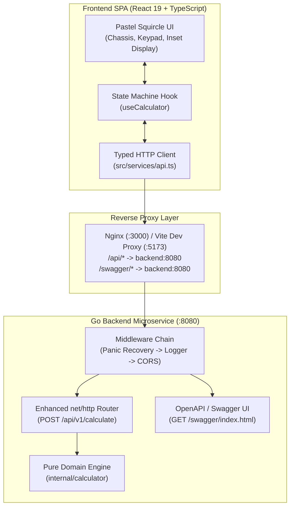

# Full-Stack Calculator Application

[](https://golang.org)
[](https://react.dev)
[](https://www.typescriptlang.org)
[](https://tailwindcss.com)
[](https://www.docker.com)
[](http://localhost:8080/swagger/index.html)

A production-grade full-stack calculator application developed for the Sezzle Technical Assessment. Built with a high-performance, stateless **Go REST microservice** and an ergonomic, accessible **React 19 + TypeScript SPA** featuring superellipse ("squircle") geometry, a soothing pastel aesthetic, and interactive Swagger OpenAPI documentation.

---

## Table of Contents
1. [Key Features](#key-features)
2. [Architecture & System Design](#architecture--system-design)
3. [Design Decisions & Technical Rationale](#design-decisions--technical-rationale)
4. [Mathematical Domain & IEEE 754 Boundary Handling](#mathematical-domain--ieee-754-boundary-handling)
5. [Quick Start & Setup](#quick-start--setup)
   - [Option A: Docker Compose (Recommended)](#option-a-docker-compose-recommended)
   - [Option B: Local Development](#option-b-local-development)
6. [Interactive Swagger & REST API Reference](#interactive-swagger--rest-api-reference)
   - [Swagger UI](#swagger-ui)
   - [API Endpoints](#api-endpoints)
   - [cURL Examples](#curl-examples)
7. [Testing & Coverage Reports](#testing--coverage-reports)
8. [AI Tooling & Prompts Log](#ai-tooling--prompts-log)

---

## Key Features

- **Full Mathematical Arity (Basic & Advanced):**
  - **Basic Operations:** Addition ($+$), Subtraction ($-$), Multiplication ($\times$), and Division ($\div$).
  - **Advanced Operations:** Exponentiation ($x^y$), Square Root ($\sqrt{x}$), and Percentage ($\%$, supporting both unary $a/100$ and contextual binary $b\%$ of $a$).
- **Strict IEEE 754 Precision Handling:**
  - Mitigates binary floating-point representation noise (`0.1 + 0.2` normalizes cleanly to `0.3`).
  - Normalizes IEEE 754 negative zero (`-0.0` $\rightarrow$ `0`).
  - Guards against `NaN` and $\pm\infty$ overflow.
- **Ergonomic Soft-Pastel Design System:**
  - Tactile superellipse ("squircle") geometry (`rounded-[2.5rem]` outer chassis, `rounded-2xl` buttons).
  - Soothing pastel color coding with WCAG AA compliance (terracotta basic operators, lavender advanced operations, sage equals, blush danger keys).
  - High-clarity typography with dynamic font scaling and tabular numeric alignment.
- **Full Physical Keyboard Accessibility:**
  - Numeric keys (`0–9`, `.`), operators (`+`, `-`, `*`, `/`, `^`, `%`, `r` for $\sqrt{x}$), `Enter` / `=` to evaluate, `Backspace` to delete, and `Escape` / `c` to clear.
- **Calculation History Drawer:**
  - Accessible slide-over drawer recording past expressions and results with one-click result re-use and history clearing.
- **Multi-Stage Containerization:**
  - Hardened non-root Go Alpine backend container.
  - Multi-stage Node 24 Vite builder into an Nginx 1.27 Alpine runtime with reverse proxying for seamless single-origin networking.

---

## Architecture & System Design

The application follows a clean monorepo architecture with a strict separation of concerns:

```
├── backend/                        # Go Microservice
│   ├── cmd/
│   │   └── server/main.go          # Microservice entrypoint & graceful shutdown
│   ├── docs/                       # Swagger 2.0 / OpenAPI definitions (swag init)
│   ├── internal/
│   │   ├── api/                    # HTTP transport layer
│   │   │   ├── handlers.go         # REST handlers & routing (net/http Go 1.22+)
│   │   │   ├── handlers_test.go    # HTTP integration tests (httptest)
│   │   │   ├── middleware.go       # CORS, panic recovery, structured slog logger
│   │   │   └── models.go           # JSON DTOs & Swagger annotations
│   │   └── calculator/             # Pure math domain layer (Zero HTTP dependencies)
│   │       ├── calculator.go       # Evaluation engine & expression formatting
│   │       ├── calculator_test.go  # Table-driven unit tests
│   │       └── errors.go           # Exported sentinel domain errors
│   ├── Dockerfile                  # Multi-stage Go build -> Alpine runtime (non-root)
│   └── go.mod
│
├── frontend/                       # React 19 + TypeScript SPA
│   ├── src/
│   │   ├── components/             # Presentational pastel squircle UI components
│   │   │   ├── Button.tsx          # Accessible tactile squircle button
│   │   │   ├── Calculator.tsx      # Main chassis & physical keyboard listener
│   │   │   ├── Calculator.test.tsx # React Testing Library integration tests
│   │   │   ├── Display.tsx         # Inset display with dynamic font sizing & alert
│   │   │   ├── HistoryDrawer.tsx   # Slide-over calculation history panel
│   │   │   └── Keypad.tsx          # Responsive 6x4 tactile button grid
│   │   ├── hooks/
│   │   │   ├── useCalculator.ts    # Deterministic calculator state machine
│   │   │   └── useCalculator.test.ts # State transition unit tests
│   │   ├── services/
│   │   │   ├── api.ts              # Typed fetch wrapper with structured error handling
│   │   │   └── api.test.ts         # Mocked client unit tests
│   │   ├── types/
│   │   │   └── calculator.ts       # Shared TypeScript interfaces & union types
│   │   ├── App.tsx                 # Centered responsive container
│   │   ├── index.css               # Tailwind v4 @theme configuration
│   │   └── main.tsx                # React DOM root mounting
│   ├── Dockerfile                  # Multi-stage Node 24 -> Nginx 1.27 Alpine runtime
│   ├── nginx.conf                  # SPA fallback + /api & /swagger reverse proxy
│   ├── package.json
│   ├── tsconfig.app.json
│   └── vite.config.ts              # Vite & Vitest configuration
│
├── docker-compose.yml              # Container orchestration & healthcheck networking
├── IMPLEMENTATION_PLAN.md          # Architectural plan & formal specifications
└── README.md                       # Complete documentation & API guide
```



---

## Design Decisions & Technical Rationale

1. **Idiomatic Standard Library Routing (Go 1.22+ `net/http`):**  
   Rather than introducing heavyweight third-party web frameworks (e.g. Gin, Echo, Fiber), the backend leverages Go 1.22's native enhanced pattern routing (`POST /api/v1/calculate`). This eliminates external runtime dependencies, minimizes attack surface, and keeps the binary minimal (< 15 MB).
2. **Strict Layer Decoupling (`internal/calculator` vs `internal/api`):**  
   The core mathematical domain engine is completely decoupled from HTTP transport. It operates exclusively on typed domain structs (`CalculationInput`, `CalculationOutput`) and returns exported sentinel errors (`ErrDivisionByZero`, `ErrNegativeSquareRoot`, `ErrOverflow`). This allows 100% pure unit testing of business logic without constructing HTTP requests.
3. **Pointer Operands in API Contract (`*float64`):**  
   In Go, a zero-value primitive `float64` defaults to `0`. By typing `Operand1` and `Operand2` as `*float64`, the JSON decoder can deterministically distinguish between an explicitly provided `0` (e.g., `{"operand1": 0}`) and an omitted/null field, enabling clean `400 Bad Request` schema validation.
4. **Deterministic HTTP Status Code Mapping:**
   - `200 OK`: Calculation successfully evaluated.
   - `400 Bad Request`: Syntax errors, unknown JSON fields (`DisallowUnknownFields`), missing operands, or empty operations (`INVALID_JSON`, `MISSING_OPERAND`, `INVALID_OPERATION`).
   - `422 Unprocessable Entity`: Syntactically valid payloads that violate real-number arithmetic domain rules: division by zero (`DIVISION_BY_ZERO`), negative square root (`NEGATIVE_SQUARE_ROOT`), float64 overflow (`NUMERIC_OVERFLOW`), or complex/undefined numbers (`DOMAIN_ERROR`).
   - `500 Internal Server Error`: Unhandled runtime exceptions captured and sanitized by panic recovery middleware (`INTERNAL_ERROR`).
5. **State Machine Separation (`useCalculator`):**  
   All calculation orchestration, chained operations, decimal validation, and history management are encapsulated in the custom `useCalculator` hook. Visual components (`Display`, `Keypad`, `Button`, `HistoryDrawer`) remain strictly presentational.
6. **Reverse Proxying for Zero-CORS Container Networking:**  
   In the Docker topology, the Nginx container proxies all requests matching `/api/` and `/swagger/` directly to `http://backend:8080` over the internal Docker network (`calc-network`). The browser communicates on a single origin (`http://localhost:3000`), completely eliminating browser CORS friction in production.

---

## Mathematical Domain & IEEE 754 Boundary Handling

Binary floating-point arithmetic can introduce representation noise inherent to the IEEE 754 specification (e.g. `0.1 + 0.2 = 0.30000000000000004` or `1.1 * 3 = 3.3000000000000003`).

To ensure precision and clean human-readable output without sacrificing range:
- **`normalizeFloat(val)`:** Formats values to 12 significant digits using Go's `'G'` format flag and parses them back.
- **Negative Zero Normalization:** IEEE 754 produces `-0.0` for `-0.0 * 5.0` or `0 / -5`. The engine normalizes `-0.0` to `0.0`.
- **Domain Errors:**
  - $a \div 0 \rightarrow$ `ErrDivisionByZero`
  - $0^{-n} \rightarrow$ `ErrDivisionByZero`
  - $\sqrt{-a} \rightarrow$ `ErrNegativeSquareRoot`
  - $(-a)^{0.5} \rightarrow$ `ErrInvalidDomain` (`NaN`)
  - Overflow ($> 1.79 \times 10^{308}$) $\rightarrow$ `ErrOverflow` ($\pm\infty$)

---

## Quick Start & Setup

### Prerequisites
- [Docker](https://docs.docker.com/get-docker/) & [Docker Compose](https://docs.docker.com/compose/) (recommended), **OR**
- [Go 1.22+](https://golang.org/dl/) and [Node.js 20+](https://nodejs.org/)

---

### Option A: Docker Compose (Recommended)

To build and run the full stack (backend, frontend, Nginx reverse proxy, and health checks) with a single command:

```bash
# Clone the repository
git clone <repository-url>
cd Sezzle_TechnicalAssessment

# Launch containers in the background
docker compose up --build -d
```

- **Frontend Application:** Open [http://localhost:3000](http://localhost:3000)
- **Interactive Swagger Documentation:** Open [http://localhost:8080/swagger/index.html](http://localhost:8080/swagger/index.html) (or [http://localhost:3000/swagger/index.html](http://localhost:3000/swagger/index.html))
- **Backend Health Check:** Open [http://localhost:8080/api/v1/health](http://localhost:8080/api/v1/health)

To view logs or stop the containers:
```bash
docker compose logs -f
docker compose down
```

---

### Option B: Local Development

#### 1. Start the Go Backend Microservice

```bash
cd backend

# Run the server on port 8080
go run ./cmd/server
```
*The backend server will start on `http://localhost:8080`.*

#### 2. Start the React Frontend Application

In a separate terminal:

```bash
cd frontend

# Install dependencies
npm install

# Start Vite development server with proxy enabled
npm run dev
```
*The frontend development server will start on [http://localhost:5173](http://localhost:5173) with automatic proxying of `/api` and `/swagger` requests to `http://localhost:8080`.*

---

## Interactive Swagger & REST API Reference

### Swagger UI
The backend includes interactive OpenAPI documentation generated via `swaggo/swag`. When the service is running, navigate to:
👉 **[http://localhost:8080/swagger/index.html](http://localhost:8080/swagger/index.html)**

---

### API Endpoints

| Method | Endpoint | Description | Status Codes |
| :--- | :--- | :--- | :--- |
| `POST` | `/api/v1/calculate` | Evaluates basic & advanced arithmetic expressions | `200`, `400`, `422`, `500` |
| `GET` | `/api/v1/health` | Service health and liveness probe | `200` |
| `GET` | `/swagger/*` | Interactive Swagger UI and OpenAPI documentation | `200` |

---

### cURL Examples

#### 1. Basic Addition (`200 OK`)
```bash
curl -X POST http://localhost:8080/api/v1/calculate \
  -H "Content-Type: application/json" \
  -d '{
    "operand1": 10.5,
    "operand2": 2.5,
    "operation": "add"
  }'
```
**Response:**
```json
{
  "result": 13,
  "operation": "add",
  "operand1": 10.5,
  "operand2": 2.5,
  "expression": "10.5 + 2.5 = 13"
}
```

#### 2. Division by Zero (`422 Unprocessable Entity`)
```bash
curl -i -X POST http://localhost:8080/api/v1/calculate \
  -H "Content-Type: application/json" \
  -d '{
    "operand1": 42,
    "operand2": 0,
    "operation": "divide"
  }'
```
**Response:**
```json
HTTP/1.1 422 Unprocessable Entity

{
  "error": {
    "code": "DIVISION_BY_ZERO",
    "message": "division by zero is undefined"
  }
}
```

#### 3. Square Root (`200 OK`)
```bash
curl -X POST http://localhost:8080/api/v1/calculate \
  -H "Content-Type: application/json" \
  -d '{
    "operand1": 81,
    "operation": "sqrt"
  }'
```
**Response:**
```json
{
  "result": 9,
  "operation": "sqrt",
  "operand1": 81,
  "expression": "√(81) = 9"
}
```

#### 4. Negative Square Root (`422 Unprocessable Entity`)
```bash
curl -i -X POST http://localhost:8080/api/v1/calculate \
  -H "Content-Type: application/json" \
  -d '{
    "operand1": -25,
    "operation": "sqrt"
  }'
```
**Response:**
```json
HTTP/1.1 422 Unprocessable Entity

{
  "error": {
    "code": "NEGATIVE_SQUARE_ROOT",
    "message": "square root of a negative number is undefined in real numbers"
  }
}
```

#### 5. Exponentiation (`200 OK`)
```bash
curl -X POST http://localhost:8080/api/v1/calculate \
  -H "Content-Type: application/json" \
  -d '{
    "operand1": 2,
    "operand2": 8,
    "operation": "power"
  }'
```
**Response:**
```json
{
  "result": 256,
  "operation": "power",
  "operand1": 2,
  "operand2": 8,
  "expression": "2 ^ 8 = 256"
}
```

#### 6. Contextual Binary Percentage (`200 OK`)
```bash
curl -X POST http://localhost:8080/api/v1/calculate \
  -H "Content-Type: application/json" \
  -d '{
    "operand1": 200,
    "operand2": 15,
    "operation": "percentage"
  }'
```
**Response:**
```json
{
  "result": 30,
  "operation": "percentage",
  "operand1": 200,
  "operand2": 15,
  "expression": "15% of 200 = 30"
}
```

#### 7. Schema Validation / Missing Operand (`400 Bad Request`)
```bash
curl -i -X POST http://localhost:8080/api/v1/calculate \
  -H "Content-Type: application/json" \
  -d '{
    "operand1": 10,
    "operation": "add"
  }'
```
**Response:**
```json
HTTP/1.1 400 Bad Request

{
  "error": {
    "code": "MISSING_OPERAND",
    "message": "second operand is required for binary operation"
  }
}
```

---

## Testing & Coverage Reports

Both the Go backend microservice and the React frontend SPA include unit and integration tests.

### Backend Tests (Go)

Execute the backend test suite with race condition detection and statement coverage profiling:

```bash
cd backend
go test -v -race -coverprofile=coverage.out ./internal/...
go tool cover -func=coverage.out
```

#### Statement Coverage Summary

| Package | Function | Statement Coverage |
| :--- | :--- | :---: |
| `internal/calculator` | `NewEngine`, `Calculate`, `FormatNumber`, `formatExpression` | **95.6%** |
| `internal/api` | `Calculate`, `Health`, `NewRouter`, `writeJSON`, `writeError` | **100.0%** |
| `internal/api` | `Recoverer`, `CORS`, `RequestLogger`, `WriteHeader` | **100.0%** |
| **Combined Total** | **All Backend Statements (`internal/...`)** | **97.8%** |

---

### Frontend Tests (React / Vitest)

Execute the frontend test suite with Vitest, React Testing Library, and v8 coverage:

```bash
cd frontend
npm run lint
npm run test:coverage
npm run build
```

#### Coverage Summary

| Directory / File | % Statements | % Branch | % Functions | % Lines |
| :--- | :---: | :---: | :---: | :---: |
| `src/components/Button.tsx` | 100.0% | 100.0% | 100.0% | 100.0% |
| `src/components/HistoryDrawer.tsx` | 100.0% | 100.0% | 100.0% | 100.0% |
| `src/hooks/useCalculator.ts` | 95.4% | 78.8% | 100.0% | 94.6% |
| `src/services/api.ts` | 95.8% | 68.8% | 100.0% | 95.8% |
| `src/components/Keypad.tsx` | 94.7% | 100.0% | 94.4% | 94.7% |
| `src/components/Calculator.tsx` | 90.2% | 90.0% | 100.0% | 90.0% |
| `src/components/Display.tsx` | 66.7% | 70.0% | 100.0% | 71.4% |
| **All Files Total** | **93.3%** | **81.7%** | **98.5%** | **93.1%** |

---

## AI Tooling & Prompts Log

In compliance with the assessment instructions (*"Share any prompts that you used in your work"*), this project employed a two-phase agentic AI engineering workflow:

### Phase 1: Staff Architecture & Formal Specification
- **Model:** Gemini 4 Argon High
- **Role:** Staff Software Architect
- **Mission:** Formalize all locked technical decisions, design the mathematical domain, establish the API contracts, define the frontend state machine, and produce an exhaustive Action Plan saved as `IMPLEMENTATION_PLAN.md`.
- **Primary Prompt Used:**
  > *"You are a Staff Software Architect operating inside Antigravity. We are building a production-grade full-stack calculator application following the technical assessment specifications... Formalize all locked technical decisions, design the mathematical domain, establish the API contracts, define the frontend state machine, and produce an exhaustive, deterministic Action Plan saved as IMPLEMENTATION_PLAN.md. Do NOT implement application code in this phase."*

### Phase 2: Deterministic Implementation & Verification
- **Model:** Gemini 3.8 Flash High
- **Role:** Principal Software Engineer
- **Mission:** Sequentially execute Milestones 1 through 6 according to `IMPLEMENTATION_PLAN.md`, enforcing test-driven verification gates, TypeScript strict compiler constraints (`verbatimModuleSyntax: true`, `erasableSyntaxOnly: true`), race condition detection, and containerization.
- **Primary Prompt Used:**
  > *"You are a Principal Software Engineer operating inside Antigravity as the executor for Phase 2. The architectural blueprint and implementation plan have already been finalized and locked by Gemini 4 Argon High in IMPLEMENTATION_PLAN.md... Read IMPLEMENTATION_PLAN.md and execute the implementation sequentially, milestone by milestone. Follow the exact directory structure, signatures, TypeScript constraints, pastel color tokens, and test requirements defined in IMPLEMENTATION_PLAN.md."*
